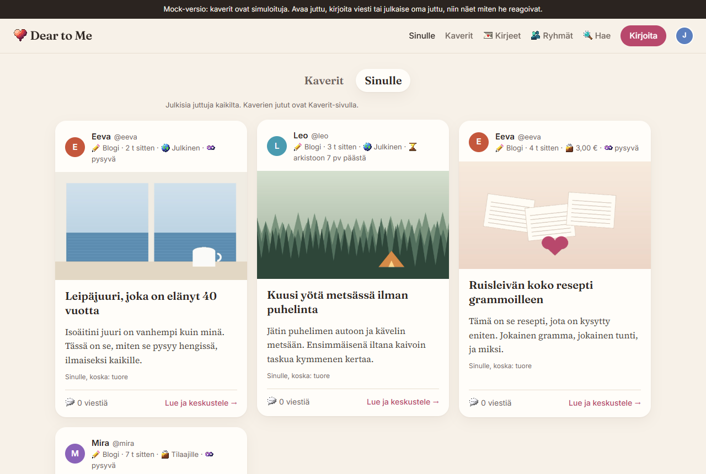
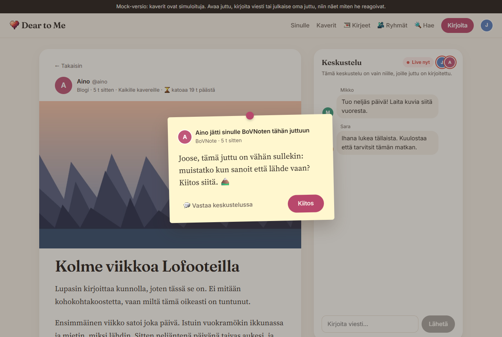
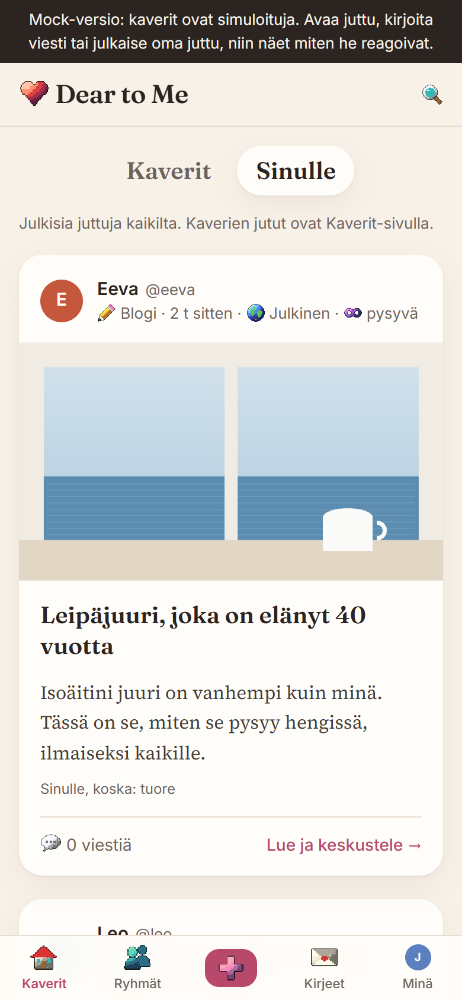

# Dear to Me

**Social media for your friends, not an audience.** Long-form blogs and vlogs for the people you
actually know, with a live conversation under every post. No like counts, no follower numbers, no
algorithm between friends, and no AI-generated content.

*Some ystävillesi, ei yleisölle.* The app is in Finnish and English.



| A post, its live conversation and a BoVNote | On a phone |
|---|---|
|  |  |

## Built in about 12 hours

The whole product, from the first idea to what is here, took about 12 hours. The ideas, the rules
and every decision are mine. The code was written with [Claude Code](https://claude.com/claude-code):
one AI coordinating several AI agents, each building a part in its own git worktree, with tests
before anything was merged. The rule against AI-generated content is about what people post, not
about the tools that build the service.

It is released as it stands: a finished, tested product that someone can take further.

## What it does

- **Posts for friends:** blogs (a cover picture, pictures and GIFs among the paragraphs) and vlogs,
  for all friends, chosen friends, a friend group, or the public.
- **A live conversation** under every post, with who is there right now.
- **Letters:** a post for one friend, with a conversation for the two of you.
- **BoVNotes:** a note hidden inside a post for chosen readers; they get it when they open the post.
- **Posts that fade:** on the free plan posts disappear in time; on paid plans you choose how long
  they live, and the rest goes to an archive.
- **Groups:** private friend groups (by invitation, joined by accepting) and open interest groups
  around a topic.
- **For You:** public posts ranked by your interests, freshness and conversation, with the reason
  shown on each card. Every number lives in one rules file (`shared/interests.ts`); nothing is
  trained, and what you read is not tracked.
- **@usernames,** public profiles, search by name, @username or topic.
- **Plans and payments (Stripe):** Lite (free), Unlimited (monthly subscriptions to writers) and
  Exclusive (single posts sold one by one), Stripe Connect payouts to writers, webhooks, consent and
  withdrawal flows, refunds.
- **Video:** uploaded straight from the browser to Cloudflare R2 in parts (resumable), length read and
  a streaming copy made with FFmpeg.
- **Trust and safety:** reports, a moderation queue with statements of reasons, suspensions,
  complaints, a notice form for people without an account, an audit log.
- **Accounts:** email and password, verification, password reset (Cloudflare Email Service), account
  deletion, invite codes and a beta mode.
- **Search engines:** real URLs, server-rendered metadata for public pages, robots.txt and a sitemap;
  private posts never leak.
- **Legal page drafts** (terms, privacy, withdrawal and refunds, content rules, contact) in Finnish and
  English. They are drafts with placeholders, not legal advice: have a lawyer review them.

## Try it

Node 24 is needed (the storage is the built-in `node:sqlite`).

```sh
npm install
npm run mock        # the whole app without a server, friends played by a script: http://localhost:5175
npm run dev         # the real app with demo people: http://localhost:5173
```

In `npm run dev` the sign-in page lists the demo accounts (`joose@demo.d2m` and so on, password
`dear-to-me-demo`). Payments, R2 and email are off until you configure them; the app works without
them.

```sh
npm run typecheck
npm run check       # ~440 API checks on servers of its own
npm run e2e         # ~70 browser steps in Microsoft Edge (playwright-core)
```

## Stack

React 18 and TypeScript with Vite; a Node server (Express and ws) run with tsx; SQLite through
`node:sqlite` with migrations and backups; Stripe; Cloudflare R2 and Email Service; FFmpeg. No UI
framework and no ORM.

## Running it for real

- `deploy/README.md`: a server (Docker and Caddy with automatic HTTPS), Stripe webhooks, R2, email,
  backups, and a checklist before launch.
- `deploy/DEMO.md`: a free demo from your own machine through a Cloudflare Tunnel.
- `deploy/.env.example`: every setting, commented.

## License

MIT. See [LICENSE](LICENSE).
